# Modelo de Datos — Maestro Platform V1

> **Fase:** 02-Planning
> **Agente:** data-architect
> **Fecha:** 2026-04-16
> **Proyecto:** PRJ-MAESTRO-V1
> **Motor:** PostgreSQL 16 (ADR-002)

---

## 1. Diagrama Entidad-Relación

```mermaid
erDiagram
    users ||--o{ company_user : has
    companies ||--o{ company_user : has
    companies ||--o{ application_company : licenses
    applications ||--o{ application_company : licensed_to
    users ||--o{ application_user : uses
    applications ||--o{ application_user : used_by
    companies ||--o{ application_user : context
    applications ||--o{ instances : deployed_as
    companies ||--o{ instances : owns
    instances ||--o{ instance_health_history : emits
    instances ||--o{ instance_lifecycle_events : emits
    applications ||--o{ hooks_deliveries : targets
    users ||--o{ oauth_access_tokens : owns
    users ||--o{ oauth_refresh_tokens : owns
    users ||--o{ audit_log : actor
    users }o--|| companies : active_company

    users {
        uuid id PK
        varchar email UK
        varchar password_hash "nullable (Entra-only users)"
        varchar entra_id_sub UK "nullable; Microsoft Entra subject id"
        uuid active_company_id FK "nullable; si el user tiene alguna empresa"
        varchar display_name
        boolean is_platform_admin "flag super-admin"
        timestamptz last_login_at "nullable"
        timestamptz created_at
        timestamptz updated_at
        timestamptz deleted_at "nullable; soft delete"
    }

    companies {
        uuid id PK
        varchar name
        varchar slug UK "regex [a-z0-9-]"
        varchar subdomain UK "para construir URLs de instancias"
        varchar status "active|suspended|inactive"
        jsonb metadata "contacto, billing placeholder, etc."
        timestamptz created_at
        timestamptz updated_at
        timestamptz deleted_at
    }

    applications {
        uuid id PK
        varchar name
        varchar slug UK "regex [a-z0-9-]"
        varchar latest_version "SemVer"
        varchar image_ref "ghcr.io/org/app:tag"
        jsonb maestro_yaml "snapshot del contrato validado"
        varchar webhook_secret_encrypted "AES-256; para HMAC de hooks salientes"
        varchar status "active|deprecated|retired"
        timestamptz created_at
        timestamptz updated_at
        timestamptz deleted_at
    }

    company_user {
        uuid company_id PK, FK
        uuid user_id PK, FK
        jsonb roles "array de strings, ej: [admin, operator]"
        jsonb permissions "overrides explícitos si hacen falta"
        boolean is_active
        timestamptz created_at
        timestamptz updated_at
    }

    application_company {
        uuid application_id PK, FK
        uuid company_id PK, FK
        varchar tier "default|pro|enterprise (metadata, sin logica V1)"
        boolean is_active
        timestamptz expires_at "nullable"
        timestamptz created_at
        timestamptz updated_at
    }

    application_user {
        uuid application_id PK, FK
        uuid user_id PK, FK
        uuid company_id PK, FK "contexto: el user accede a esta app dentro de esta empresa"
        jsonb roles "roles dentro de la app específica"
        jsonb permissions
        timestamptz created_at
        timestamptz updated_at
    }

    instances {
        uuid id PK
        uuid application_id FK
        uuid company_id FK
        varchar status "provisioning|starting|healthy|degraded|suspended|destroyed|purged"
        varchar container_id "nullable hasta que exista"
        varchar network_name "app-slug-company-net"
        varchar db_host "contenedor dedicado"
        varchar db_name
        varchar db_user
        varchar db_password_encrypted "AES-256"
        varchar image_ref
        varchar resources_memory "ej: 512m"
        varchar resources_cpu "ej: 0.5"
        jsonb env_vars_encrypted "secretos inyectados"
        timestamptz provisioned_at
        timestamptz last_healthy_at
        timestamptz destroyed_at "soft delete efectivo"
        timestamptz purge_eligible_at "destroyed_at + 90 días"
        timestamptz purged_at "nullable"
        timestamptz created_at
        timestamptz updated_at
    }

    instance_health_history {
        bigserial id PK
        uuid instance_id FK
        timestamptz at
        varchar status "ok|fail|timeout"
        int response_ms "nullable si fail"
        int http_code "nullable si timeout"
        varchar failure_reason "nullable"
    }

    instance_lifecycle_events {
        bigserial id PK
        uuid instance_id FK
        timestamptz at
        varchar event_type "created|started|healthy|degraded|restarted|suspended|destroyed"
        varchar previous_status "nullable"
        varchar new_status
        jsonb metadata "container_id, exit_code, reason, user_id, etc."
    }

    hooks_deliveries {
        uuid id PK
        uuid application_id FK
        uuid company_id FK
        varchar event_type "on_user_added|on_user_removed"
        jsonb payload "sin datos sensibles; solo IDs"
        varchar payload_hmac "SHA256 HMAC del payload"
        varchar status "pending|delivered|failed"
        int attempts
        timestamptz last_attempt_at
        int last_response_code "nullable"
        varchar last_failure_reason "nullable"
        timestamptz created_at
    }

    revoked_tokens {
        varchar jti PK "JWT ID"
        uuid user_id FK
        timestamptz revoked_at
        timestamptz expires_at "para poder limpiar registros"
    }

    oauth_clients {
        uuid id PK
        varchar name
        varchar secret
        boolean password_client
        boolean revoked
    }

    oauth_access_tokens {
        varchar id PK "jti"
        uuid user_id FK
        uuid client_id FK
        varchar name
        jsonb scopes
        boolean revoked
        timestamptz expires_at
        timestamptz created_at
    }

    oauth_refresh_tokens {
        varchar id PK
        varchar access_token_id FK
        boolean revoked
        timestamptz expires_at
    }

    audit_log {
        bigserial id PK
        timestamptz at "precision milis"
        uuid actor_user_id "nullable si sistema"
        uuid company_id "contexto al momento, nullable"
        inet actor_ip
        varchar action "users.create|users.update|instances.provision|etc."
        varchar resource_type
        uuid resource_id "nullable"
        jsonb data_before "nullable"
        jsonb data_after "nullable"
    }
```



> **Nota sobre multi-tenant**: la relación "usuario pertenece a empresa" es M-N (`company_user`). La relación "usuario usa app dentro de empresa X" es una ternaria M-N-N (`application_user` con `company_id`). Esto permite que un mismo user tenga roles distintos en una misma app según la empresa activa.

---

## 2. Entidades Principales — Detalle

### 2.1 `users`

El registro canónico de identidad. Un usuario puede existir sin empresa asignada (admin platform) y puede existir con auth user/pass, Entra-only, o ambos.

- `password_hash` se deja `NULL` si el usuario solo autentica con Microsoft.
- `entra_id_sub` es el `sub` del JWT de Microsoft Entra ID. Permite vincular automáticamente en el primer login.
- `is_platform_admin = true` otorga acceso a endpoints `/api/admin/*` sin depender de `company_user`.
- Soft delete: `deleted_at NOT NULL`. Al borrar se revocan los tokens activos y se emiten hooks `on_user_removed`.

### 2.2 `companies`

La empresa tenant. Su `slug` es el identificador estable en URLs, logs y labels Docker; se valida con regex `^[a-z0-9][a-z0-9-]{1,48}[a-z0-9]$`.

`subdomain` es usado por Traefik al rutear: `app-<app_slug>-<company_subdomain>.<MAESTRO_BASE_DOMAIN>`. Por default = `slug`, configurable para aliasing.

### 2.3 `applications`

Catálogo. Cada app tiene su `slug`, imagen Docker (ghcr.io/...), contrato validado (`maestro_yaml` como JSONB del YAML parseado), y `webhook_secret_encrypted` (AES-256) usado para firmar hooks salientes HMAC-SHA256.

Cuando un dev pushea una versión nueva vía CI/CD y llama a `/api/apps/register`, se re-valida el YAML, se actualiza `latest_version`, `image_ref` y `maestro_yaml`.

### 2.4 Pivotes M-N

- **`company_user`**: usuario ∈ empresa. `roles[]` = nombres de roles otorgados a nivel empresa. `is_active = false` bloquea acceso sin borrar el registro (reversible).
- **`application_company`**: empresa licencia app. Campos de licencia presentes pero sin lógica V1 (DEC-018).
- **`application_user`**: relación ternaria (user, app, company). Controla permisos finos del usuario dentro de una app específica bajo el contexto de una empresa. Cuando el usuario cambia la empresa activa, se cargan sus roles desde aquí.

### 2.5 `instances`

Registro por instancia desplegada. Campos clave:
- `status`: máquina de estados (ver §2.5.1).
- `db_password_encrypted`, `env_vars_encrypted`: AES-256 (RNF-012). Descifrado solo al inyectar al contenedor.
- `purge_eligible_at = destroyed_at + 90 days` (DEC-019). Job de purga diario elimina instancias cuyo `purge_eligible_at` ha vencido (y graba en audit_log).

### 2.5.1 Máquina de estados de `instances.status`

```
provisioning ──✓──▶ starting ──✓──▶ healthy ⇆ degraded
      │                │               │         │
      └──✗──▶ failed   └──✗──▶ failed   ▼         ▼
                                  suspended ──▶ destroyed ──▶ purged
                                                   ▲              (irreversible)
                                         user-stop/DELETE
```

Transiciones válidas codificadas en Laravel con state machine (spatie/laravel-model-states o enum + validador).

### 2.6 `audit_log`

Implementación de no-negociable 9 (ADR-008). Inmutable a nivel DB vía triggers:

```sql
CREATE OR REPLACE FUNCTION audit_log_block_update_delete()
RETURNS TRIGGER AS $$
BEGIN
    RAISE EXCEPTION 'audit_log is INSERT-only';
END;
$$ LANGUAGE plpgsql;

CREATE TRIGGER audit_log_no_update BEFORE UPDATE ON audit_log
    FOR EACH ROW EXECUTE FUNCTION audit_log_block_update_delete();

CREATE TRIGGER audit_log_no_delete BEFORE DELETE ON audit_log
    FOR EACH ROW EXECUTE FUNCTION audit_log_block_update_delete();
```

Acciones registradas (lista no exhaustiva, se expande según feature):
`auth.login.success`, `auth.login.fail`, `auth.microsoft.login`, `auth.logout`, `auth.token.refresh`, `auth.token.revoke`, `auth.company.switch`, `users.create`, `users.update`, `users.delete`, `companies.create/update/delete`, `applications.create/update/delete`, `licenses.grant/revoke`, `instances.provision/start/stop/destroy`, `gateway.forward`, `hooks.dispatch`, `admin.impersonate` (si alguna vez se agrega; prohibido V1 pero el slot existe).

Purga: una única operación privilegiada (usuario `maestro_purger`) puede ejecutar `DELETE FROM audit_log WHERE at < now() - interval '<retencion_legal>'`. Esta operación se registra ella misma como `audit_log.purge` en... otro sistema (outbox, archivado en Azure Blob) para no contradecirse. V1: la retención coincide con la de backups (30 días); evaluable extender en post-V1 si compliance lo exige.

### 2.7 `revoked_tokens`

JWT stateless pero revocables: al logout o revocación, el `jti` se inserta aquí con su `expires_at`. El endpoint `/api/auth/validate` consulta Redis (cache) y si falla, consulta esta tabla. Job diario elimina `revoked_tokens` cuyo `expires_at < now()`.

### 2.8 Passport Tables

`oauth_*` son gestionadas por Laravel Passport via `php artisan passport:install`. No modificamos su schema.

---

## 3. Estrategia de Migración

- **Herramienta**: Laravel Migrations (`php artisan make:migration`).
- **Naming**: `YYYY_MM_DD_HHMMSS_<descripcion_verbo>.php`, ej: `2026_04_20_100000_create_users_table.php`.
- **Reversibilidad**: todas las migraciones implementan `up()` y `down()` funcionales. El PR reviewer verifica que `down()` no rompa datos.
- **Triggers DB (audit_log)**: migrados con `DB::unprepared(...)` en `up()` y `DB::unprepared('DROP TRIGGER ...')` en `down()`.
- **Orden sugerido de migraciones** (primeros 12):
  1. `create_users_table`
  2. `create_companies_table`
  3. `create_applications_table`
  4. `create_company_user_pivot`
  5. `create_application_company_pivot`
  6. `create_application_user_pivot`
  7. `create_oauth_tables` (via `passport:install`)
  8. `create_revoked_tokens_table`
  9. `create_instances_table`
  10. `create_instance_health_history_table`
  11. `create_instance_lifecycle_events_table`
  12. `create_hooks_deliveries_table`
  13. `create_audit_log_table_with_triggers`

---

## 4. Índices y Optimización

Indexes planificados (basados en los patrones de acceso del API):

```sql
-- users
CREATE INDEX idx_users_email ON users(email) WHERE deleted_at IS NULL;
CREATE INDEX idx_users_entra_sub ON users(entra_id_sub) WHERE entra_id_sub IS NOT NULL;
CREATE INDEX idx_users_active_company ON users(active_company_id);

-- companies
CREATE UNIQUE INDEX idx_companies_slug ON companies(slug) WHERE deleted_at IS NULL;
CREATE UNIQUE INDEX idx_companies_subdomain ON companies(subdomain) WHERE deleted_at IS NULL;

-- applications
CREATE UNIQUE INDEX idx_applications_slug ON applications(slug) WHERE deleted_at IS NULL;

-- instances
CREATE INDEX idx_instances_company_app ON instances(company_id, application_id) WHERE destroyed_at IS NULL;
CREATE INDEX idx_instances_status ON instances(status);
CREATE INDEX idx_instances_purge_eligible ON instances(purge_eligible_at) WHERE purged_at IS NULL;

-- audit_log
CREATE INDEX idx_audit_at ON audit_log(at DESC);
CREATE INDEX idx_audit_actor ON audit_log(actor_user_id, at DESC);
CREATE INDEX idx_audit_company ON audit_log(company_id, at DESC) WHERE company_id IS NOT NULL;
CREATE INDEX idx_audit_resource ON audit_log(resource_type, resource_id);

-- revoked_tokens
CREATE INDEX idx_revoked_expires ON revoked_tokens(expires_at);   -- para purga

-- instance_health_history
CREATE INDEX idx_health_instance_at ON instance_health_history(instance_id, at DESC);

-- hooks_deliveries
CREATE INDEX idx_hooks_status ON hooks_deliveries(status) WHERE status != 'delivered';
CREATE INDEX idx_hooks_app ON hooks_deliveries(application_id, created_at DESC);
```

**Particionamiento**: V1 **no particiona**. Con la escala DEC-017 (1 empresa × 7 apps), el tamaño de audit_log crece a <10k filas/día en peor caso. Evaluable a V2.

---

## 5. Políticas de Datos

### 5.1 Retención (DEC-019)

| Dato | Retención | Acción tras vencer |
|---|---|---|
| Backups de BDs (Maestro + instancias) | 30 días | lifecycle policy en Azure Blob |
| Instancias `destroyed` | 90 días | job diario `purge_eligible_at < now()` → elimina contenedor, red, volumen, BD dedicada y registro; emite `audit_log.purge_instance` |
| `audit_log` | mínimo legal aplicable (V1: 30 días alineado con backups) | purga privilegiada con auditoría en sistema externo (Azure Blob "frozen") |
| `revoked_tokens` | hasta `expires_at` | job diario |
| `instance_health_history` | 30 días | job semanal |
| `instance_lifecycle_events` | sin límite V1 | volumen bajo, retener |
| `hooks_deliveries` delivered | 30 días | job semanal |
| `hooks_deliveries` failed | retener para diagnóstico | manual |
| Soft-deleted rows en users/companies/applications | sin purga V1 | auditoría manual; job de purga evaluable V2 |

### 5.2 Backup / Restore

- **Frecuencia**: diario, ventana 02:00–04:00 (configurable).
- **Qué se respalda**:
  - BD del Maestro entera (`pg_dumpall`).
  - Cada BD de instancia (`pg_dump <db>`).
  - Docker volumes de Redis (para queue recovery) — opcional.
- **Cifrado**: `age` o `gpg` con llave simétrica derivada de `BACKUP_ENCRYPTION_KEY`.
- **Destino**: Azure Blob Storage, contenedor `maestro-backups`, con lifecycle 30 días.
- **Pre-migración**: snapshot adicional con tag `pre-migration-<timestamp>` antes de cada `php artisan migrate` en producción. Lo ejecuta el script `scripts/deploy.sh` del humano.
- **Restore runbook**: documentado en Fase 05 (`docs/05-operations/RUNBOOKS.md`).

### 5.3 Aislamiento Multi-tenancy

**Doble capa**:

1. **Red Docker**: cada instancia en `app-<app_slug>-<company_slug>-net`. Contenedor de app conecta también a `maestro-network` (para recibir Traefik). Contenedor de BD **solo** a la red privada.
2. **Aplicación**: middleware `EnforceCompanyIdFilter` en el SDK agrega `WHERE company_id = $current` a todas las queries de la app. Además, el Maestro emite `X-Auth-Company-Id` y si el cliente intenta pasar otro company_id en body, se rechaza 403.

Tests obligatorios (QA-tester en Fase 03):
- Test A: admin de empresa A intenta leer datos de empresa B → 403 / empty.
- Test B: un bug en una app huésped que olvide filtrar: el middleware del SDK agrega el filtro automáticamente → sin leak.
- Test C: un pentesting de red (nmap desde un contenedor de instancia A al DB de instancia B) → sin conectividad.

### 5.4 Cifrado

- **At rest**: PostgreSQL data volume sobre Docker volume cifrado (ext4 sobre LUKS en VPS, fuera del framework). El framework entrega docs que recomiendan esta configuración.
- **Secretos en BD**: AES-256-GCM con `MAESTRO_ENCRYPTION_KEY` (rotable). Campos cifrados: `instances.db_password_encrypted`, `instances.env_vars_encrypted`, `applications.webhook_secret_encrypted`.
- **Rotación de `MAESTRO_ENCRYPTION_KEY`**: runbook semi-automático: comando artisan `php artisan maestro:rotate-encryption-key --new-key=...` re-cifra todos los registros y actualiza la env var. A ejecutar con ventana de mantenimiento.
- **En tránsito**: TLS 1.2+ en perímetro; comunicación interna Docker sin TLS (red privada), pero hooks salientes firmados HMAC-SHA256.

---

## 6. Patrones de acceso (referencia para api-designer)

| Patrón | Endpoints involucrados | Índice clave |
|---|---|---|
| Login user/pass | /api/auth/login | idx_users_email |
| Login Microsoft | /api/auth/microsoft/callback | idx_users_entra_sub |
| Validar token (ForwardAuth) | /api/auth/validate | Redis cache; fallback PK oauth_access_tokens + revoked_tokens.jti |
| Cambio de empresa activa | /api/auth/switch-company | idx_users_active_company, company_user PK |
| Listar apps licenciadas del user | /api/portal/my-apps | application_user (company_id, user_id) + application_company is_active |
| Admin listar empresas | /api/admin/companies?page=... | idx_companies_slug |
| Admin listar instancias de empresa | /api/admin/instances?company_id=... | idx_instances_company_app |
| Query audit_log por user | /api/admin/audit-log?actor=... | idx_audit_actor |
| Provisioning queue worker | jobs internos | idx_instances_status |
| Purga de instancias | job diario | idx_instances_purge_eligible |
| Health check report | internos | idx_health_instance_at |

---

## 7. Volúmenes Docker y paths

| Volumen | Contenido | Backup |
|---|---|---|
| `maestro-db-data` | PostgreSQL data dir del Maestro | diario a Blob |
| `maestro-redis-data` | Redis AOF | opcional |
| `maestro-traefik-acme` | Let's Encrypt certs | diario |
| `maestro-secrets` | bind mount `/secrets` con oauth keys + master keys | gestionado por humano en VPS |
| `app-<slug>-<company>-db-data` | PostgreSQL de una instancia | diario |

---

## 8. Semillas iniciales (seeder obligatorio)

El seeder de prod inicial (`DatabaseSeeder` en prod) crea:
1. `companies`: una empresa `LLyAsoc` (slug `llyasoc`, subdomain `llyasoc`) → tenant inicial DEC-017.
2. `users`: un usuario admin platform (`admin@llyasoc.com`, `is_platform_admin = true`). Password se genera aleatorio, se loguea una sola vez al deploy, y debe rotarse al primer login.
3. Passport install (`php artisan passport:install --personal`).

Fin. Todo lo demás se crea vía endpoints `/api/admin/*`.

---

## 9. Coherencia con requisitos

| RF/RNF | Cobertura en modelo |
|---|---|
| RF-001–RF-006 | users, oauth_*, revoked_tokens, company_user |
| RF-010–RF-015 | users, companies, applications + 3 pivotes |
| RF-020–RF-021 | audit_log (con triggers) |
| RF-030–RF-034 | instances, instance_health_history, instance_lifecycle_events |
| RF-040–RF-044 | (infra: Traefik) |
| RF-050–RF-056 | users.active_company_id + application_user |
| RF-060–RF-064 | applications.maestro_yaml + SDK side |
| RF-080–RF-081 | gateway: transient; se registra en audit_log |
| RF-090 | hooks_deliveries |
| RF-100–RF-102 | instance_health_history + lifecycle_events alimentan dashboards |
| RF-110–RF-112 | backups (fuera del schema, scripts) |
| RNF-012 | campos `*_encrypted` con AES-256 |
| RNF-015 | network_name por instancia |
| RNF-016 | db_password_encrypted >= 32 chars |
| RNF-017 | audit_log + triggers |
