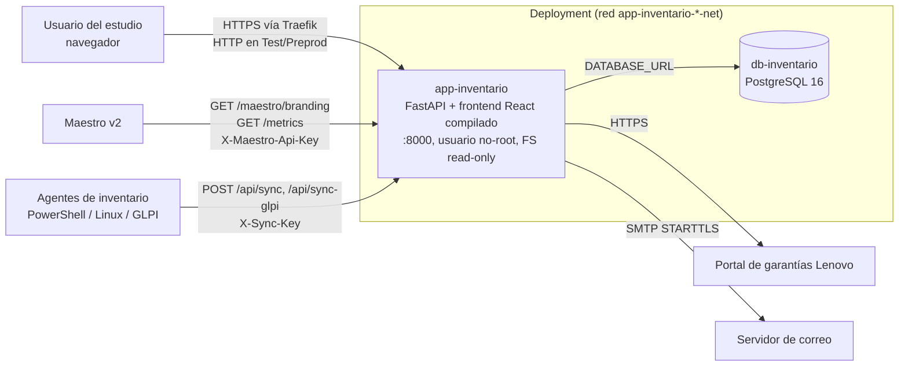

# Inventario LLYA v2 — Arquitectura (fase 02-planning)

## 1. Contenedores (C4 nivel 2)

- **Una sola imagen:** el Dockerfile compila el frontend (Node 20) y lo copia a la imagen de runtime (Python 3.11
  slim), donde FastAPI lo sirve como archivos estáticos. Frontend y API comparten origen, así que no hace falta CORS.
- **La base no se expone al host**; solo la ve la app dentro de la red del deployment.
- **Sin estado en el contenedor:** los adjuntos van a la base (ADR-001) y el contenedor corre con `read_only: true`.
- **Arranque (`docker-entrypoint.sh`):** espera la base → `seed.py` (crea tablas y triggers, sincroniza roles y
  siembra el superadmin) → `uvicorn`. Si el seeder falla, el contenedor no arranca.

## 2. Backend (`app/backend/`)

| Módulo | Responsabilidad |
|---|---|
| `config.py` | Toda la configuración por variables de entorno. Normaliza `DATABASE_URL`. |
| `database.py` | Motor SQLAlchemy, modelos de negocio e `init_db()` (aplica las migraciones de Alembic). |
| `migrations/` | Migraciones de Alembic (`0001`: esquema inicial y trigger de audit inmutable). |
| `auth.py` | Usuarios, roles y permisos; login, refresh, logout, bloqueo, política de passwords, administración de usuarios. |
| `seed.py` | Migración y seeder idempotente del superadmin (fase 05). |
| `main.py` | App FastAPI: endpoints de negocio, contrato con el Maestro, middlewares, frontend estático. |
| `contexto.py` | Contexto por request (`request_id`, IP, user-agent, usuario) y logs JSON. |
| `audit.py` | Audit log (solo INSERT). |
| `metricas.py` | Métricas Prometheus. |
| `mailer.py` | Notificaciones SMTP (silencioso ante fallos). |
| `ratelimit.py` | Limitador por IP (slowapi). |

## 3. Frontend (`app/frontend/`)

React 19 + Vite. `App.jsx` es el shell y las secciones viven en `src/secciones/`. `api.js` es el cliente HTTP:
guarda el access token en memoria y renueva la sesión con `/auth/refresh`. `AuthContext.jsx` maneja la sesión, y
`CambioObligatorio.jsx` fuerza el cambio de la contraseña inicial. Los temas usan variables CSS en `styles.css`
(`ui.tailwise: false`, ADR-004).

## 4. Decisiones (ADRs)

| ADR | Decisión |
|---|---|
| [ADR-001](../adr/ADR-001-adjuntos-en-la-base.md) | Adjuntos en la base, sin volumen de storage |
| [ADR-002](../adr/ADR-002-jwt-hs256.md) | JWT firmado con HS256 usando `JWT_SECRET` |
| [ADR-003](../adr/ADR-003-alcance-sin-usermanager.md) | La v2 no depende del UserManager: Licencias y Nómina quedan fuera |
| [ADR-004](../adr/ADR-004-sin-tailwise.md) | Se mantiene el sistema de diseño propio en vez de Tailwise |

## 5. Stack

| Capa | Tecnología |
|---|---|
| Backend | Python 3.11, FastAPI 0.137, SQLAlchemy 2.0, psycopg 3, PyJWT, passlib+bcrypt, slowapi, prometheus-client |
| Frontend | React 19, Vite 8, recharts, exceljs, html2canvas, lucide-react |
| Base | PostgreSQL 16 (tests con SQLite) |
| Infra | Docker (multi-stage, digests fijos), Docker Compose por ambiente, Dokploy (Test/Preprod), Maestro v2 (producción) |
| CI | GitHub Actions: `ci.yml` (validación) y `deploy.yml` (build, Trivy, ghcr, cosign) |
